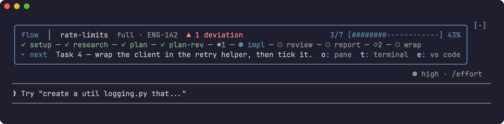
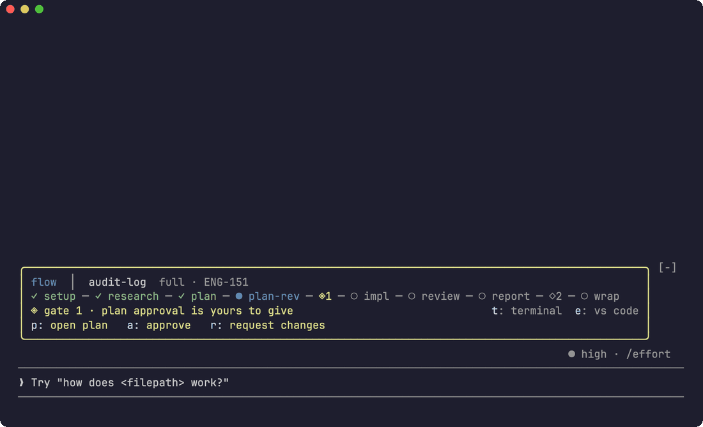
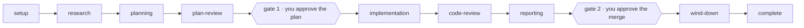
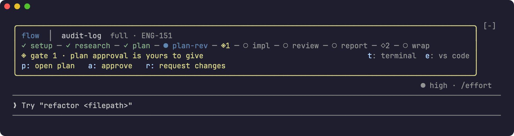
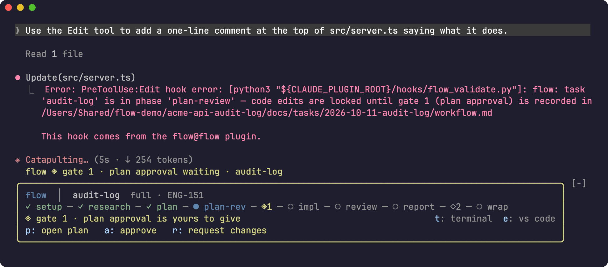
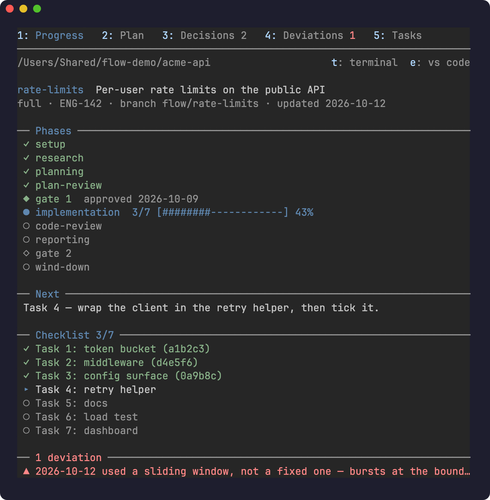
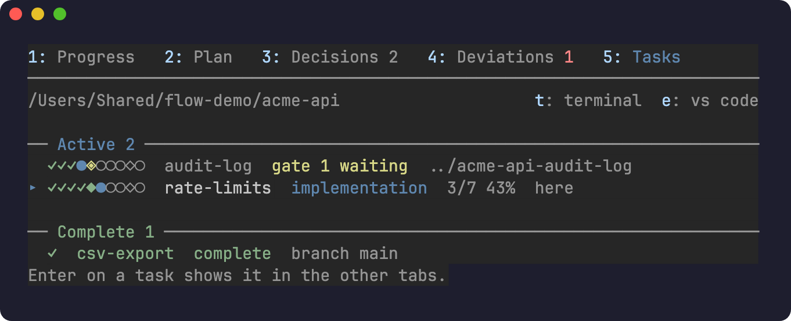
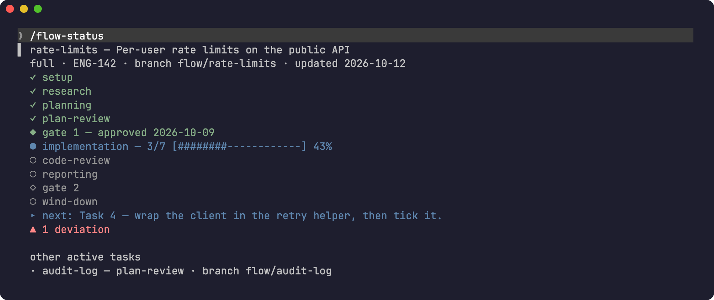
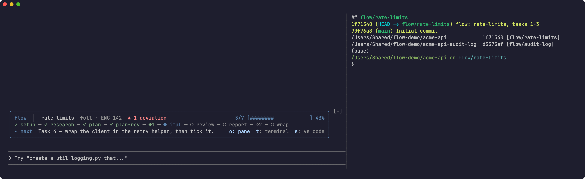
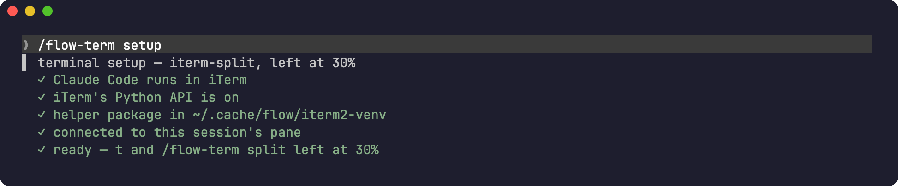

# flow

**A phased development workflow for Claude Code, with gates a hook enforces.**
Research, plan, approve, implement, review against the plan, approve the merge,
wind down: each step leaves its state in a file, so any session can pick the
work up, and Claude can't edit code until you've approved the plan.



## Why flow

- **Gates, not good intentions.** A PreToolUse hook refuses code edits before
  you approve the plan (gate 1), and refuses skipping a phase. It isn't a line
  in a prompt that a long session can forget.
- **State lives in the repo.** Each task is a folder with `workflow.md` (phase,
  decisions, progress, deviations) and `plan.md`. Close the session, compact,
  switch machines: `/flow` resumes where the file says.
- **Plans that say what they assumed.** Gate 1 also requires the plan to list
  its assumptions, so implementation never starts on a guess nobody saw.
- **You can see where you are.** A coloured rail above the prompt, a pane with
  the plan and checklist, and toasts when anything moves.



## How it works



- **Full mode** runs every phase. **Lite mode**, for small, well-understood
  work, skips research and the report; gate 2 then follows code review. Setup
  recommends one and you confirm.
- **Gate 1** comes after a critic agent has attacked the plan once. **Gate 2**
  comes with a report built from real command output and an open PR.
- Each task gets its own branch, and a worktree if your `.flow.md` asks for
  one.
- Approval is always your own message. Flow records it in the decision log,
  and the validator checks that line before it lets the phase move on.

## See where you are

All of this is drawn by a Claude Code mod in `hooks/mod/`. It's display only:
with mods switched off, flow's phases and gates work exactly the same.

**The rail.** Every phase and gate, the progress bar, and the next action,
above the prompt. Periwinkle is where the task is, sage is done, straw is
waiting on you, rose is a deviation or a block.



At a gate the frame turns straw and offers **open plan**, **approve** and
**request changes**. They only draft the reply into the prompt; you press
Enter.

**Blocked, visibly.** When the validator refuses an edit, the reason is in the
transcript and in a toast.



**`/flow-pane`.** Progress, the plan, the decision log, deviations, and every
task across the repo's worktrees, on tabs 1 to 5.

| Progress | Tasks |
|---|---|
|  |  |

**`/flow-status`.** The same picture as text, with no model turn.



## Work in the worktree

Press `t` on the rail (or the pane, or run `/flow-term [task]`) and flow opens
a terminal in that task's worktree, split beside Claude Code. `e` (or
`/flow-code [task]`) opens the worktree in your editor. Nothing opens unless
you ask.



By default that's an iTerm split on the right and VS Code. The terminal,
editor, split side and split size are settings. For any split iTerm's
AppleScript can't make, flow uses iTerm's Python API, and `/flow-term setup`
checks what that needs and tells you how to fix anything missing.



## Install

```
/plugin marketplace add fifersheep/flow
/plugin install flow@flow
```

Then, in a repo:

```
/flow add per-user rate limits to the public API
```

## Requirements

- Claude Code with mods; tested on 2.1.296. Without mods you lose the
  pictures, not the workflow.
- Python 3.9 or later, and git.
- For the terminal button: macOS with iTerm, Terminal or Warp, or any OS
  inside tmux. iTerm splits other than right or below at half need iTerm's
  Python API (Settings → General → Magic → Enable Python API).

## Commands

| Command | What it does |
|---|---|
| `/flow <description>` | Start a task: branch, worktree, task folder, mode |
| `/flow` | Resume the task on this branch, or choose between several |
| `/flow status` | List active tasks |
| `/flow shape <idea>` | Brainstorm an idea into agreed tracker tickets (before any task exists) |
| `/flow-status` | Where the task stands, with no model turn |
| `/flow-pane [tab]` | Open the pane: `progress`, `plan`, `decisions`, `deviations`, `tasks` |
| `/flow-term [task \| setup]` | Terminal in a task's worktree, or the split's setup checklist |
| `/flow-code [task]` | Open a task's worktree in your editor |

## Configuration

**Per repo:** a `.flow.md` at the root, checked in. Copy
[`templates/flow-config-example.md`](templates/flow-config-example.md). It sets:

- the verify command and where task folders and worktrees go
- optional tracker sync: moves the ticket to In Progress, In Review and Done as
  the task moves
- optional per-phase shell commands (`## on`), run once when a task enters a
  phase

**Per person:** the plugin's settings, in `/config`.

| Setting | Default | Options |
|---|---|---|
| Terminal | `iterm-split` | `iterm-split`, `iterm-tab`, `iterm-window`, `terminal`, `warp`, `tmux` |
| Editor | `vscode` | `vscode`, `cursor`, `zed` |
| Split side | `right` | `right`, `left`, `top`, `bottom` |
| Split size (%) | `50` | 10–90, of Claude Code's pane |

**Escape hatch:** `force: true` in a task's `workflow.md` frontmatter lifts its
gates. It's for you, not Claude: flow's skills never set it, though the
validator doesn't stop an edit that does.

## What the gates do and don't cover

The validator watches Claude's Write and Edit tools. Through them, a code edit
before gate 1 is refused, as is a phase change that skips a step or lacks its
gate line. It doesn't police shell commands: a `sed` or a redirect run through
Bash can still change a file. The gates stop the normal path; they aren't a
sandbox.

More detail: [docs/reference.md](docs/reference.md), and the design in
[docs/specs/](docs/specs/2026-07-04-flow-workflow-design.md).

## Development

```
python3 -m unittest discover tests -v      # hooks and scripts
claude plugin test .                       # the mod
claude plugin validate .                   # manifests and mod scan
python3 scripts/check_version_bump.py main # version is bumped
```

Every PR bumps the version (see [CLAUDE.md](CLAUDE.md)). The screenshots are
captured from a live session in a made-up repo by
[`scripts/demo/shoot.py`](scripts/demo/shoot.py), so they can be retaken when
the UI changes.

## License

[Apache License 2.0](LICENSE). Fork it and change it as you like; keep the
[NOTICE](NOTICE) file with anything you redistribute.
